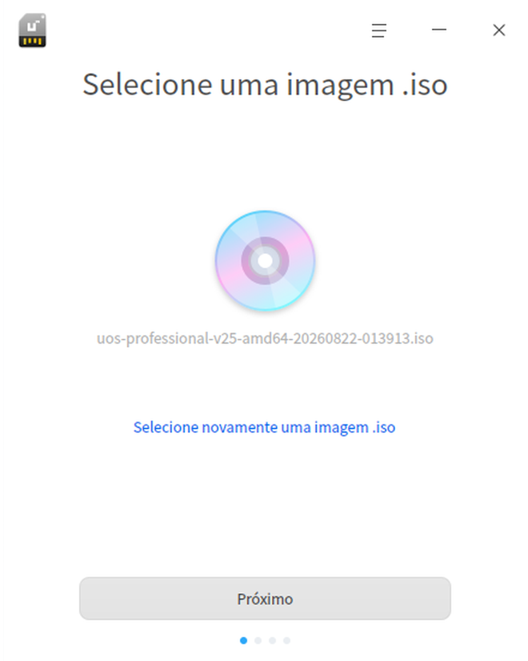
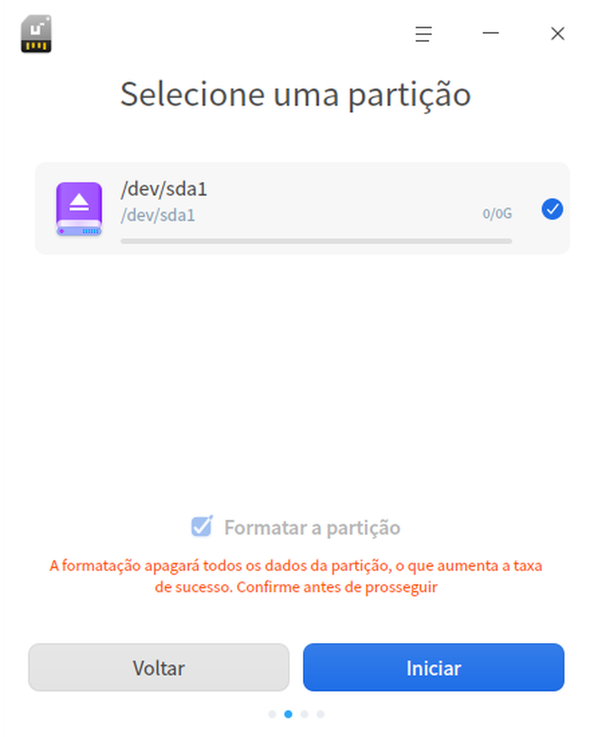
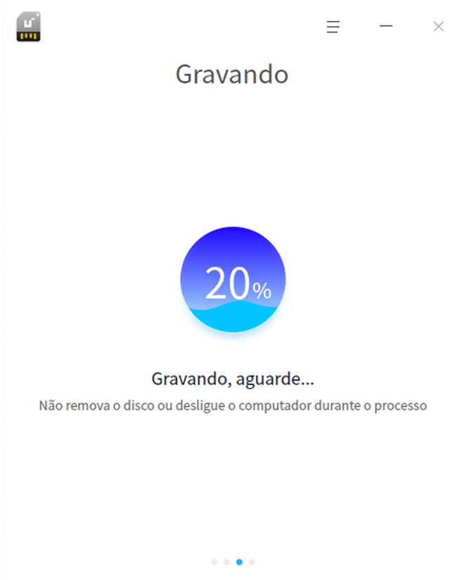

# Criador de disco de inicialização|deepin-boot-maker|

## Visão geral

O Criador de disco de inicialização é uma pequena ferramenta que grava arquivos de imagem do sistema em mídias de instalação, como pendrives. A interface é enxuta e a operação é simples.

## Primeiros passos

Você pode iniciar o Criador de disco de inicialização, fechá-lo ou criar um atalho para ele das seguintes formas.

### Iniciar o Criador de disco de inicialização

1. Clique no ícone do iniciador na barra de tarefas  para abrir a interface do iniciador.
2. Role a roda do mouse para cima ou para baixo ou use a busca para localizar o ícone do Criador de disco de inicialização e clique nele para iniciar.
3. Clique com o botão direito em  para:
 - Clicar em **Enviar para a área de trabalho** e criar um atalho na área de trabalho.
 - Clicar em **Enviar para a barra de tarefas** e fixar o aplicativo na barra de tarefas.
 - Clicar em **Iniciar automaticamente ao ligar** e adicionar o aplicativo aos itens de inicialização, para que ele seja executado automaticamente ao ligar o computador.

### Fechar o Criador de disco de inicialização

   - Na interface do Criador de disco de inicialização, clique em  para sair do aplicativo.
   - Na barra de tarefas, clique com o botão direito em  e selecione **Fechar tudo** para sair do aplicativo.
   - Na interface do Criador de disco de inicialização, clique em  e selecione **Sair** para sair do aplicativo.

## Operações

### Preparação

1. Baixe no site oficial o arquivo de imagem do sistema mais recente.
2. Prepare um pendrive de pelo menos 8 GB.
3. Obtenha o Criador de disco de inicialização.
   - O sistema já vem com o Criador de disco de inicialização; procure-o no iniciador.
   - Acesse o site oficial e baixe a versão especificada do Criador de disco de inicialização.
   - No sistema Windows, é possível extrair o arquivo xxx_boot_maker.exe da imagem de instalação para o computador.

### Selecionar o arquivo de imagem

Você pode selecionar o arquivo de imagem de duas formas:

- Clique no link **Selecione uma imagem .iso**, escolha o arquivo de imagem baixado e clique em **Próximo**.
- Arraste o arquivo de imagem diretamente para a interface da ferramenta e clique em **Próximo**.

### Selecionar a partição

Selecione o pendrive em que o disco de inicialização será criado; se o pendrive tiver várias partições, só é possível escolher a primeira. Clique em **Iniciar** ou em **Voltar**.

- Iniciar: recomenda-se marcar **Formatar partição**; antes de criar o disco, faça backup dos dados do pendrive.
- Voltar: retorna à interface de seleção do arquivo de imagem.

### Criação concluída

O processo leva algum tempo; aguarde com paciência e, durante a criação, não remova o pendrive nem desligue o computador. Quando a barra de progresso estiver completa e a mensagem **Criação concluída** aparecer, o disco de inicialização está pronto.

&nbsp;&nbsp;&nbsp;&nbsp;&nbsp;&nbsp;&nbsp;&nbsp;&nbsp;&nbsp;&nbsp;&nbsp;&nbsp;

### Falha na criação

Se a criação falhar, a causa pode ser uma das seguintes:

- Formato de disco incorreto

- Espaço em disco insuficiente

- Erro de montagem do disco

- Erro ao extrair a imagem

Quando ocorre um erro desconhecido, a janela de falha na criação exibe o botão "Enviar feedback". Ao clicar em **Enviar feedback**, você é levado ao fórum correspondente para relatar o problema.

## Menu principal

No menu principal, você pode alternar o tema da janela e consultar o manual de ajuda, entre outras operações.

### Tema

O tema da janela inclui tema claro, tema escuro e tema do sistema.

1. Na interface do Criador de disco de inicialização, clique em.
2. Clique em **Tema** e escolha uma cor de tema.

### Ajuda

1. Na interface do Criador de disco de inicialização, clique em .
2. Clique em **Ajuda** para consultar o manual e conhecer melhor o Criador de disco de inicialização.

### Sobre

1. Na interface do Criador de disco de inicialização, clique em .
2. Clique em **Sobre** para ver a versão e a descrição do Criador de disco de inicialização.

### Sair

1. Na interface do Criador de disco de inicialização, clique em .
2. Clique em **Sair**.
